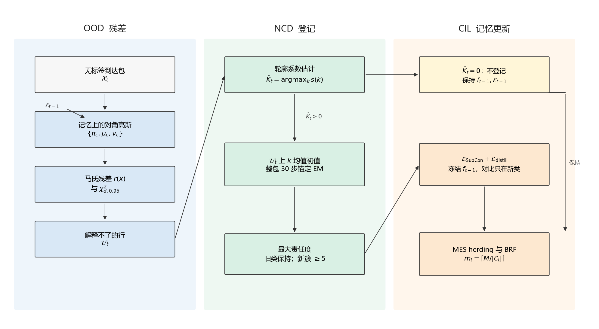
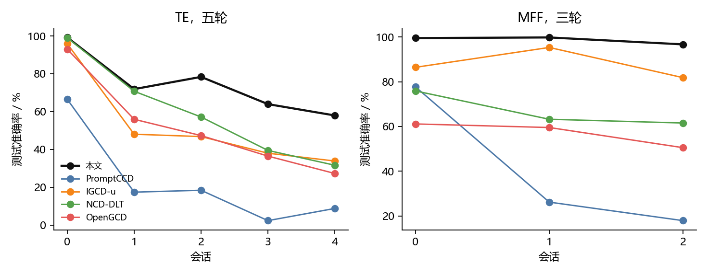
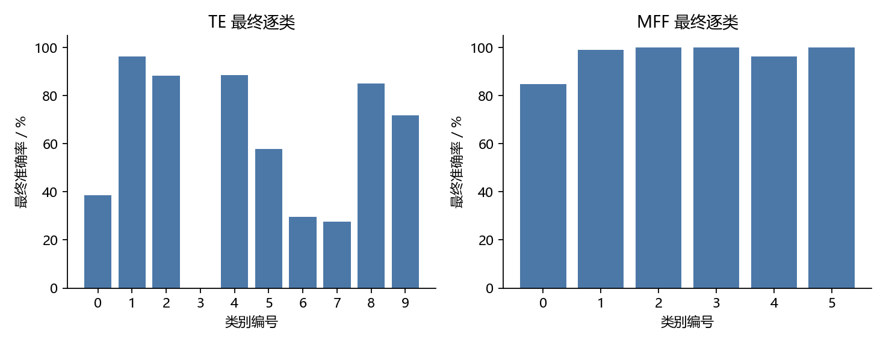
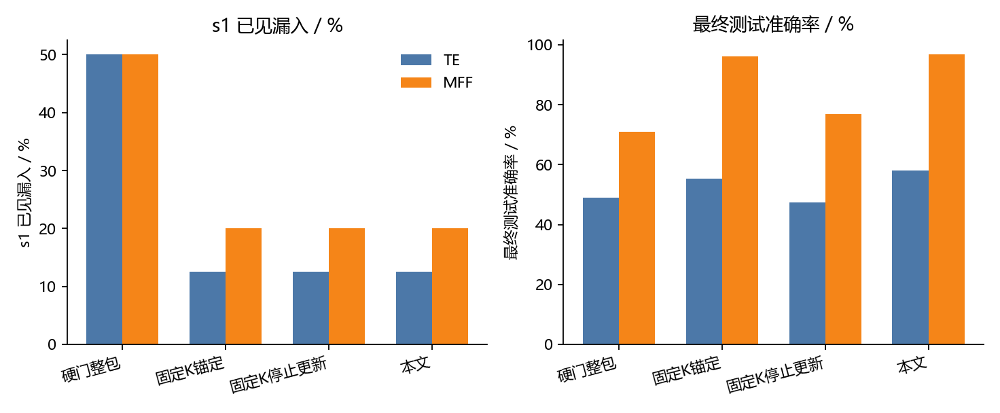
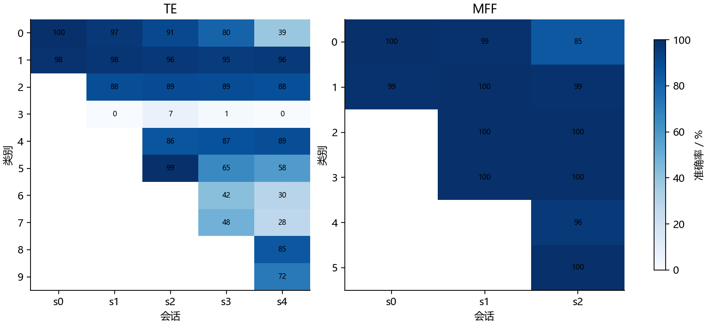
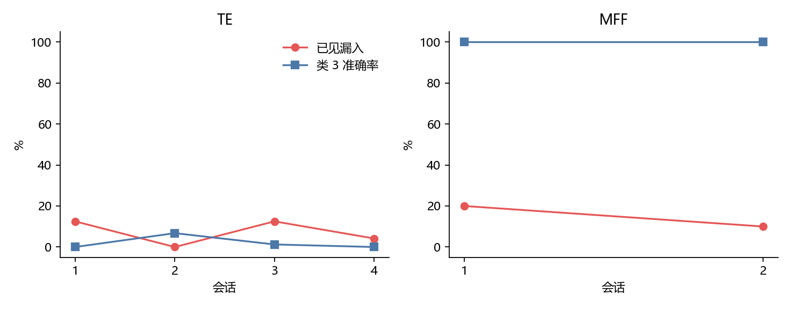
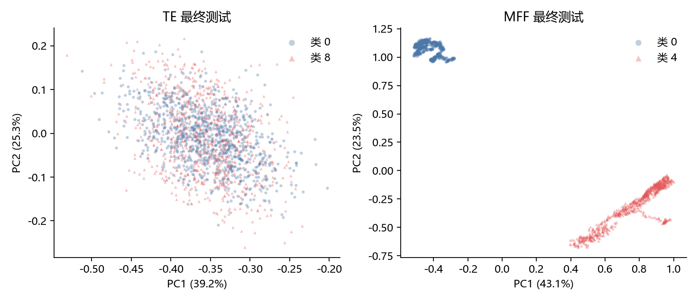

# Meet again: Open-World Fault Diagnosis

## 摘要

工业传感器会持续送来无标签的监测数据。到达的数据里，既有训练时见过、此后再次出现的故障，也有尚未命名的新异常。现有开放世界异常诊断或者将这些到达一律拒绝，已见故障因此被登记为新异常；或者要等到新故障有了真实标签，才将其纳入模型。另一些工作能够在无标签数据中发现新异常，但停留在单批样本或一个异常分数上，类别编号不能进入下一轮检测。

本文在故障样本有限、类别不平衡的多轮会话中研究这一问题。首轮会话提供标签，此后的到达包没有标签，其中混有再次出现的已见故障。本文将已见故障的再现与未知拒识分开，使再现样本保持原有类别；在新类个数未知的条件下，把可分离的新异常登记为后续会话继续使用的类别，不可分的成分保持未登记；并在新类入类之后，于固定记忆预算下抑制灾难性遗忘，使已见故障仍然可辨。

## 1 引言

工业设备故障诊断用于保障生产线的安全运行并降低非计划停机。实验室和离线测试中的训练数据通常来自固定工况，类别集合预先确定，样本分布较为均衡，标签也较为完备。设备长期服役时，训练阶段从未出现的故障会不断到来，工况漂移和设备差异还会改变数据分布。诊断模型因此不能只在一个固定的类别集合上完成分类，还要在无标签的到达数据中认出再次出现的已见故障，并接纳可以分开的新异常。

闭集诊断假定测试类别均包含于训练类别之中，未知故障会被判入某个已知类别。开放集诊断改为拒绝未知样本，避免将没见过的故障误诊为已知故障；当无标签到达同时含有已见故障的再现和新异常时，二者会被一并拒绝，再现的已见故障随之失去原有类别。类增量诊断可以在新故障到达后继续更新模型，但新故障在到达时带有真实标签。无标签条件下的新异常发现能够把未标注数据分成若干新类，现有工作或者处理一次图像数据池，或者只输出异常分数，类别编号不进入下一轮传感器检测。

本文沿用有限故障样本上的类增量数据条件：故障样本少于正常样本，类别分布不平衡。在这一条件下，三件事同时发生。无标签到达中含有再次出现的已见故障，整包拒识会使这些故障失去原有类别。新异常没有标签，个数也不预知，只有可分离的部分能够获得进入后续会话的类别编号，不可分的部分保持未登记。新异常入类之后，检测还要在固定的记忆预算下继续进行，已见故障在后续会话中仍然要能够辨认。这三件事分别对应混合到达下已知类与新类的可辨识、类别数未知时的新类发现，以及固定记忆下的灾难性遗忘。

本文的贡献有三点。

（1）混合到达下，已知类与新类在二元拒识中不可辨。本文用记忆样本拟合旧类对角高斯，并在整包 EM 中把旧分量的均值和方差锚回这些记忆；最大后验落在旧分量上的样本保持原类，不登记为新异常。

（2）类别数未知且没有新类标签时，一次性的未知标记不能成为可延续的类别。本文只在马氏残差超过卡方界限的样本上用轮廓系数估计新分量个数，再以这些样本的 KMeans 中心初始化新分量；不足样本量的簇整簇丢弃，保留的新分量分配后续会话继续使用的类别编号，且不并回旧类。

（3）开放世界中，新异常入类后标签空间随阶段扩大，固定记忆下的更新会引起灾难性遗忘。本文将后续检测组织为阶段式结构，分别为 OOD、NCD 和 CIL 三个主要阶段，并通过残差行进入新类估计、最大后验决定登记、登记结果驱动固定记忆更新的级联协议，提高模型在多轮与未知数据相遇时的可用性。

## 2 相关工作与问题形式化

面向传感器数据的开放世界异常诊断大体沿三个方向展开：拒识、增量和无标签的新异常发现。半监督诊断是相邻的一条主线，其类别集合通常在训练前已经确定。本文将诊断写成会话序列 $t = 0, 1, \ldots, T$。第 $t$ 轮的到达包记为 $\mathcal{X}_t$，截至上一轮已注册的类别集合记为 $\mathcal{C}_{t-1}$。本文的会话设定由这三条路线各自停止的位置写出。

拒识将样本划分为已知类与未知类，并拒绝未知样本，以避免把没见过的故障判成已知故障。监督对比学习结合负样本离群增强的开集诊断［1］、基于极值理论的开集诊断［2］以及 GOOFD［3］均将未知样本拒之门外。CFDG 在工况发生变化时仍然拒绝未知故障［4］。这些方法提高了运行时的稳健性。若已见故障混在无标签到达之中，它们同样会被拒绝，从而无法保留原有类别。由此，当 $t \ge 1$ 时，$\mathcal{X}_t$ 只含监测向量、不提供标签，并分解为再现子集 $\mathcal{X}_t^{\mathrm{s}}$ 与新异常子集 $\mathcal{X}_t^{\mathrm{n}}$，满足 $\mathcal{X}_t = \mathcal{X}_t^{\mathrm{s}} \cup \mathcal{X}_t^{\mathrm{n}}$，且 $\mathcal{X}_t^{\mathrm{s}}$ 的真实类别落在 $\mathcal{C}_{t-1}$ 中。再现样本的预测应满足 $\hat{y}(x) \in \mathcal{C}_{t-1}$。漏入定义为

$$
L_t = \frac{\left|\{ x \in \mathcal{X}_t^{\mathrm{s}} : \hat{y}(x) \notin \mathcal{C}_{t-1} \}\right|}{\left|\mathcal{X}_t^{\mathrm{s}}\right|}.
$$

这批再现样本所涉及的已见类别记为被污染的旧类 $c^{\star} \in \mathcal{C}_{t-1}$。

增量方法在新故障到达后更新模型，新故障带有真实标签。OWFD-UCPM 在人工筛选并标注之后再进行增量［5］。SCLIFD 研究故障样本有限、类别不平衡条件下的类增量诊断，新故障到达时仍然有标签［6］。OD-ViTFScL 则在新故障上使用 $K \in \{1, 5, 10\}$ 个真实标签完成后续学习［7］。本文沿用 SCLIFD 的样本条件与入类之后的更新：故障样本数量有限，各类规模不平衡。记忆预算为常数 $M$，第 $t$ 轮每类配额为 $\lceil M / |\mathcal{C}_t| \rceil$，总条数不随 $t$ 增加。会话由有标签的首轮 $(\mathcal{X}_0, \mathcal{Y}_0)$ 建立初始检测器。当 $t \ge 1$ 时，$\mathcal{X}_t$ 不提供新故障标签。尚未到来的类别不进入 $\mathcal{X}_t$，也不进入第 $t$ 轮测试集 $\mathcal{T}_t$。新类入类之后，对每个已见类 $c \in \mathcal{C}_{t-1}$，后续测试仍须辨认 $c$。

无标签的新异常发现不向新异常提供真实标签，而由模型将新异常分成若干类别。AnomalyNCD 在一次工业图像池中发现多种新异常［8］。MOSAD 对多变量时间序列输出异常分数［9］。二者都不把类别编号保留到下一轮传感器会话。由此，新异常个数 $K_t$ 不作为输入。能够与 $\mathcal{C}_{t-1}$ 分开的成分获得新编号并进入 $\mathcal{C}_t$，故 $\mathcal{C}_{t-1} \subseteq \mathcal{C}_t$，这些类别出现在后续的 $\mathcal{T}_t$ 中；难以分离的成分不进入 $\mathcal{C}_t$。多登记的类别个数记为假新类 $F_t$。终局准确率 $A_T$ 在类别集合 $\mathcal{C}_T$ 上计算。

半监督诊断以少量有标签样本带动无标签样本。SSCIBN［10］和 SSFC［11］同时具有类增量的形式，其类别仍来自已有标签或预先划定的固定集合 $\mathcal{C}$。本文的无标签样本出现在 $\mathcal{X}_t$（$t \ge 1$）中，类别集合随可分离的新异常由 $\mathcal{C}_{t-1}$ 扩大为 $\mathcal{C}_t$。

上述设定在 TE 与 MFF 上评价。TE 取 $T = 4$（共五轮），$c^{\star} = 1$；MFF 取 $T = 2$（共三轮），$c^{\star} = 0$。符号与两个数据集上的取值见表 1。

表 1 问题设定中的符号与参数

| 符号 | 含义 | 取值或约束 |
| --- | --- | --- |
| $t$ | 会话序号 | $t = 0, 1, \ldots, T$ |
| $T$ | 最后一轮序号 | TE 为 $4$，MFF 为 $2$ |
| $\mathcal{X}_t$ | 第 $t$ 轮到达包 | $t \ge 1$ 时不含标签 |
| $\mathcal{X}_t^{\mathrm{s}}$ | 再现的已见故障 | $|\mathcal{X}_t^{\mathrm{s}}| / |\mathcal{X}_t| \approx 0.2$ |
| $\mathcal{X}_t^{\mathrm{n}}$ | 新异常 | $\mathcal{X}_t \setminus \mathcal{X}_t^{\mathrm{s}}$ |
| $\mathcal{C}_{t-1}$ | 截至上一轮已注册的类别 | $\mathcal{C}_{t-1} \subseteq \mathcal{C}_t$ |
| $\hat{y}(x)$ | 样本 $x$ 的预测类别 | 再现样本应落在 $\mathcal{C}_{t-1}$ |
| $L_t$ | 漏入 | 见第 2 节定义 |
| $c^{\star}$ | 被污染的旧类 | TE 为 $1$，MFF 为 $0$ |
| $(\mathcal{X}_0, \mathcal{Y}_0)$ | 首轮有标签数据 | 用于建立初始检测器 |
| $\mathcal{T}_t$ | 第 $t$ 轮测试集 | 只含截至第 $t$ 轮已到达的类别 |
| $M$ | 记忆总条数 | TE 为 $100$，MFF 为 $10$；不随 $t$ 增加 |
| $\lceil M / |\mathcal{C}_t| \rceil$ | 每类记忆配额 | 已注册类别等额分配 |
| $K_t$ | 第 $t$ 轮新异常个数 | 不作为模型输入 |
| $F_t$ | 假新类个数 | 多登记的类别数 |
| $A_T$ | 终局准确率 | 在 $\mathcal{C}_T$ 上计算 |

## 3 分析

本节说明三个科学问题如何在上述设定中出现。

整包拒识把到达包中未能解释为已知类的样本全部视为未知。再次出现的已见故障因此与新异常进入同一个未知集合，并在后续被登记为新类。漏入随之升高，被混入的旧类在下一轮也不再稳定地保持原有编号。二元的已知—未知假设不能辨认混合到达中的旧类再现。

新类没有标签，个数也没有事先给出。只有在当前到达包中能够与旧类分开的成分才会获得类别编号，并出现在后续会话的测试中。样本过少，或与旧类在特征上重叠的成分，保持未登记。未知基数下的新类发现以可分性为界。

类别编号发出之后，检测器在固定条数的记忆上更新。新类上的更新会改变旧类已经形成的决策。若后到达的类别与某个旧类在特征上重叠，该旧类在后续会话中的可辨性下降。这是固定记忆约束下的灾难性遗忘。

## 4 方法

第 $t$ 轮（$t\ge 1$）只观察无标签到达包 $\mathcal{X}_t=\{x_i\}_{i=1}^{n_t}\subset\mathbb{R}^d$。已注册类别为 $\mathcal{C}_{t-1}$，其记忆为 $\mathcal{E}_{t-1}=\{(e, y)\}$，每类条数不超过 $m_{t-1}=\lceil M/|\mathcal{C}_{t-1}|\rceil$。分配在监测向量上完成，不使用编码器，也不读取 $K_t$、$\mathcal{X}_t^{\mathrm{s}}$ 或未来类别。编码器 $f_{t-1}$ 只在登记完成之后、于新类样本和旧记忆上更新。一次到达由算法 1 给出，总体架构见图 1。



图 1 第 $t$ 轮（$t\ge 1$）的总体架构。左列在记忆 $\mathcal{E}_{t-1}$ 上拟合旧类对角高斯，用马氏残差划出 $\mathcal{U}_t$。中列在 $\mathcal{U}_t$ 上估计 $\hat{K}_t$。$\hat{K}_t=0$ 时不登记，沿用 $f_{t-1}$ 与 $\mathcal{E}_{t-1}$。$\hat{K}_t>0$ 时，以 $\mathcal{U}_t$ 的 $k$ 均值中心为初值，在整包上做锚定期望最大化；最大责任度落在旧分量上的样本保持原类，不少于 5 行的新簇才登记。右列只在出现新类时，用 $\mathcal{L}_{\mathrm{SupCon}}+\mathcal{L}_{\mathrm{distill}}$ 更新编码器，再按配额 $m_t$ 重做记忆并拟合平衡随机森林。

### 4.1 旧类对角高斯与残差

在 $\mathcal{E}_{t-1}$ 上为每个 $c\in\mathcal{C}_{t-1}$ 拟合一个对角高斯。记该类记忆的均值和方差为 $\mu_c\in\mathbb{R}^d$、$v_c\in\mathbb{R}^d_{+}$，方差下界为 $\epsilon=10^{-4}$。类先验取记忆条数的频率 $\pi_c=|\mathcal{E}_{t-1}^{(c)}|/|\mathcal{E}_{t-1}|$。样本 $x$ 在旧类混合上的对数密度为

$$
\log p_{\mathrm{old}}(x)=\log\sum_{c\in\mathcal{C}_{t-1}}\pi_c\,\mathcal{N}\!\left(x;\mu_c,\mathrm{diag}(v_c)\right),
$$

$$
\log\mathcal{N}\!\left(x;\mu,\mathrm{diag}(v)\right)=-\frac12\sum_{j=1}^{d}\left(\log(2\pi v_j)+\frac{(x_j-\mu_j)^2}{v_j}\right).
$$

后验最大的旧类记为 $c(x)=\arg\max_{c}\pi_c\,\mathcal{N}(x;\mu_c,\mathrm{diag}(v_c))$。对该分量的平方马氏残差为

$$
r(x)=\sum_{j=1}^{d}\frac{\left(x_j-\mu_{c(x),j}\right)^2}{v_{c(x),j}}.
$$

取 $\chi^2_{d,0.95}$ 为自由度 $d$ 的卡方分布 $0.95$ 分位。解释不了的行构成

$$
\mathcal{U}_t=\{x\in\mathcal{X}_t:r(x)>\chi^2_{d,0.95}\}.
$$

$\mathcal{U}_t$ 只用来估计新分量个数并给出初值。残差不超过界限的行仍进入随后的整包分配，但不会因为残差本身被写成新类。

### 4.2 新分量个数

在 $\mathcal{U}_t$ 上搜索整数 $k$。搜索区间为 $[\max(2,k_{\min}),\min(k_{\max},|\mathcal{U}_t|-1)]$，其中 $k_{\min}=2$、$k_{\max}=8$。若该区间不能同时包含 $k=2$ 和 $k=3$，则令 $\hat{K}_t=0$，本轮不登记新类，编码器和记忆保持 $t-1$。否则对每个候选 $k$ 在 $\mathcal{U}_t$ 上做 $k$ 均值，计算轮廓系数

$$
s(k)=\frac{1}{|\mathcal{U}_t|}\sum_{x\in\mathcal{U}_t}\frac{b(x)-a(x)}{\max\{a(x),b(x)\}},
$$

其中 $a(x)$ 是 $x$ 到同簇其他点的平均距离，$b(x)$ 是到最近其他簇的平均距离。取

$$
\hat{K}_t=\arg\max_{k} s(k),
$$

得分相同则保留较小的 $k$。$\hat{K}_t$ 不是协议中的 $K_t$。

### 4.3 锚定期望最大化与登记

混合含 $|\mathcal{C}_{t-1}|$ 个旧分量和 $\hat{K}_t$ 个新分量，共 $L=|\mathcal{C}_{t-1}|+\hat{K}_t$ 个。新分量的均值用 $\mathcal{U}_t$ 上的 $k$ 均值中心初始化，初始方差取 $\mathcal{X}_t$ 各维方差的均值，权重初始为 $1/L$。对 $\ell=1,\ldots,L$ 和 $x_i\in\mathcal{X}_t$，责任度

$$
\gamma_{i\ell}=\frac{\pi_\ell\,\mathcal{N}(x_i;\mu_\ell,\mathrm{diag}(v_\ell))}{\sum_{\ell'=1}^{L}\pi_{\ell'}\,\mathcal{N}(x_i;\mu_{\ell'},\mathrm{diag}(v_{\ell'}))}.
$$

期望最大化进行 $30$ 步。每步先由当前参数计算 $\gamma_{i\ell}$，再更新全部分量；更新后立刻把旧分量锚回记忆上的估计，

$$
\mu_c\leftarrow\mu_c^{(\mathcal{E})},\qquad v_c\leftarrow v_c^{(\mathcal{E})},\qquad c\in\mathcal{C}_{t-1}.
$$

新分量保留本步的更新。因此到达包可以拉动新分量，不能改写旧类的位置和尺度。

收敛后取 $\ell(x_i)=\arg\max_{\ell}\gamma_{i\ell}$。$\ell(x_i)$ 落在旧分量上时，$x_i$ 保持该旧类编号，不进入注册。落在第 $h$ 个新分量上时，暂时记簇号 $h$。若某个新簇的行数少于 $n_{\min}=5$，整簇丢弃。保留的簇按出现顺序接在 $\max\mathcal{C}_{t-1}$ 之后分配新编号，即使其中心靠近某个旧类也不并回旧编号。本轮登记集合记为 $\mathcal{R}_t$，并令 $\mathcal{C}_t=\mathcal{C}_{t-1}\cup\mathcal{R}_t$。未进入 $\mathcal{R}_t$ 的行保持未登记。

### 4.4 固定记忆下的更新

若 $\mathcal{R}_t=\emptyset$，则 $f_t=f_{t-1}$，$\mathcal{E}_t=\mathcal{E}_{t-1}$。否则在本轮新类样本与全部旧记忆上更新残差网络 $f$。两个视图由同一向量的坐标重排得到，特征做 $\ell_2$ 归一化。监督对比损失只加在新类样本上。记锚点 $i$ 的正样本集合为 $P(i)$，同批其余样本为 $A(i)$，温度为 $\tau$，

$$
\mathcal{L}_{\mathrm{SupCon}}=\sum_{i}\frac{-1}{|P(i)|}\sum_{p\in P(i)}\log\frac{\exp(z_i^{\top} z_p/\tau)}{\sum_{a\in A(i)}\exp(z_i^{\top} z_a/\tau)}.
$$

旧记忆样本不进入 $\mathcal{L}_{\mathrm{SupCon}}$。它们与 $f_{t-1}$ 的冻结副本比较批内相似度：学生和教师各自把旧记忆特征的非对角相似度做成分布 $p$ 与 $q$，蒸馏项为交叉熵 $\mathcal{L}_{\mathrm{distill}}=-\sum_j q_j\log p_j$。总损失不加额外系数，

$$
\mathcal{L}=\mathcal{L}_{\mathrm{SupCon}}+\mathcal{L}_{\mathrm{distill}}.
$$

更新后每类配额改为 $m_t=\lceil M/|\mathcal{C}_t|\rceil$。旧记忆截断到 $m_t$ 条；新类在本轮保留的行上按 MES 做 herding，使被选样本的运行均值追踪该类特征均值，直到 $m_t$ 条。平衡随机森林只在 $\mathcal{E}_t$ 的 $\ell_2$ 归一化特征上重新拟合。

### 4.5 推理与编号

测试集 $\mathcal{T}_t$ 只含 $\mathcal{C}_t$ 中的类别。预测为

$$
\hat{y}(x)=\mathrm{BRF}\!\left(\frac{f_t(x)}{\|f_t(x)\|_2}\right).
$$

$c\in\mathcal{C}_0$ 的样本用原编号与 $\hat{y}$ 比较。$\mathcal{R}_t$ 中的编号只在计算 $A_t$、$L_t$ 和 $F_t$ 时与真实类别做一次一一对应，该对应不回写 $\mathcal{C}_t$、$\mathcal{E}_t$ 或 $f_t$。

```latex
\begin{algorithm}[t]
\caption{第 $t$ 轮无标签到达的登记与更新}
\begin{algorithmic}[1]
\Require 到达包 $\mathcal{X}_t$，记忆 $\mathcal{E}_{t-1}$，类别 $\mathcal{C}_{t-1}$，编码器 $f_{t-1}$
\State 在 $\mathcal{E}_{t-1}$ 上拟合 $\{\pi_c,\mu_c,v_c\}_{c\in\mathcal{C}_{t-1}}$
\State 对 $x\in\mathcal{X}_t$ 计算残差 $r(x)$，得到 $\mathcal{U}_t=\{x:r(x)>\chi^2_{d,0.95}\}$
\State $\hat{K}_t\leftarrow$ 在 $\mathcal{U}_t$ 上最大化轮廓系数 $s(k)$；区间不能比较 $k=2,3$ 时 $\hat{K}_t\leftarrow 0$
\If{$\hat{K}_t=0$}
  \State \Return $f_{t-1},\mathcal{E}_{t-1},\mathcal{C}_{t-1}$
\EndIf
\State 用 $\mathcal{U}_t$ 的 $\hat{K}_t$ 个 $k$ 均值中心初始化新分量
\For{$\tau_{\mathrm{em}}=1,\ldots,30$}
  \State 在 $\mathcal{X}_t$ 上计算责任度 $\gamma_{i\ell}$ 并更新全部分量
  \State 将旧分量锚回 $(\mu_c^{(\mathcal{E})},v_c^{(\mathcal{E})})$
\EndFor
\State $\mathcal{R}_t\leftarrow\{\text{最大责任度落在新分量上、且簇大小}\ge 5\text{ 的新编号}\}$
\State $\mathcal{C}_t\leftarrow\mathcal{C}_{t-1}\cup\mathcal{R}_t$，新编号不并入旧类
\If{$\mathcal{R}_t\neq\emptyset$}
  \State 以 $\mathcal{L}_{\mathrm{SupCon}}+\mathcal{L}_{\mathrm{distill}}$ 更新 $f_t$
  \State 按 $m_t=\lceil M/|\mathcal{C}_t|\rceil$ 做 MES herding，得到 $\mathcal{E}_t$，并重拟合 BRF
\Else
  \State $f_t\leftarrow f_{t-1}$，$\mathcal{E}_t\leftarrow\mathcal{E}_{t-1}$
\EndIf
\State \Return $f_t,\mathcal{E}_t,\mathcal{C}_t$
\end{algorithmic}
\end{algorithm}
```

## 5 实验

实验表都先写成 csv，图由这些表绘制。准确率是该轮全体测试样本上的 $A_t$，已知类平均不进入这些表。四个基线把同一划分画成 224 栅格后送入各自的视觉骨干；本文直接使用已经缩放到 $[0,1]$ 的监测向量。因此下面的对照是同一会话协议下的结果，骨干和输入并不相同。MFF 只有三轮，不补成五轮。

### 5.1 数据划分与基线

TE 为五轮，MFF 为三轮。$t=0$ 使用标签建立初始检测器。此后到达包不提供标签，其中已见故障占该包的 $0.2$。记忆条数固定，TE 为 $100$，MFF 为 $10$，并在已注册类别之间等额分配。随机种子固定。各类条数、测试规模和标签是否进入训练见表 2。

表 2 会话划分，见 `tables/split.csv`。TE 首轮训练 $548$ 条，类 $0$ 与类 $1$ 为 $500/48$；此后每轮到达 $120$ 条，其中已见 $24$ 条。MFF 首轮训练 $220$ 条，类 $0$ 与类 $1$ 为 $200/20$；此后每轮到达 $50$ 条，其中已见 $10$ 条。测试集只含截至该轮已经到达的类别。

四个基线都不读取协议中的 $K_t=2$，簇数由各自原方法估计。

PromptCCD 用高斯混合提示池做持续类别发现，提示随阶段更新，类别数由 GMP 的分裂与合并得到（Cendra、Zhao、Han，ECCV 2024）。

IGCD 在增量过程中同时保留旧类并发现新类，无标签数据里可以混有已见类别（Zhao、Mac Aodha，ICCV 2023）。本文的 IGCD-u 在首轮之后不把无标签样本的标签写回有标签集，新类个数来自密度峰。

NCD-DLT 面向动态到达的长尾无标签数据，先将特征收成哈希码，再按码的样本数与置信区间合并，合并后的码数作为簇数。

OpenGCD 把开放世界识别分成拒识、新类发现和增量学习三段：先做开集拒识，再用 Brent 搜索估计新类个数，然后在记忆上增量更新（Gao 等，arXiv:2308.06926，2023）。

### 5.2 主要实验

各轮测试准确率见表 3，折线见图 2。

表 3 各轮测试准确率，见 `tables/session_acc.csv`。



图 2 由 `tables/session_acc.csv` 绘制。TE 上本文五轮为 $99.2\%$、$71.9\%$、$78.4\%$、$64.0\%$、$58.0\%$。同一协议下 PromptCCD 为 $66.5\%$、$17.4\%$、$18.4\%$、$2.4\%$、$8.8\%$，IGCD-u 为 $95.9\%$、$48.1\%$、$46.8\%$、$38.0\%$、$33.9\%$，NCD-DLT 为 $99.0\%$、$70.8\%$、$57.2\%$、$39.5\%$、$31.7\%$，OpenGCD 为 $93.0\%$、$56.0\%$、$47.3\%$、$36.5\%$、$27.3\%$。MFF 上本文三轮为 $99.5\%$、$99.8\%$、$96.7\%$；PromptCCD 为 $77.7\%$、$26.2\%$、$17.9\%$，IGCD-u 为 $86.4\%$、$95.3\%$、$81.8\%$，NCD-DLT 为 $75.9\%$、$63.2\%$、$61.5\%$，OpenGCD 为 $61.1\%$、$59.5\%$、$50.5\%$。五轮算术平均在 TE 上本文为 $74.3\%$，三轮算术平均在 MFF 上本文为 $98.7\%$。会话平均只作汇总，比较时以每一轮为准。

最终逐类准确率见表 4，本文的柱状图见图 3。

表 4 最终逐类准确率，见 `tables/final_per_class.csv`。



图 3 由 `tables/final_per_class.csv` 中本文的行绘制。TE 终局上类 $1$ 为 $96.4\%$，类 $0$ 降到 $38.5\%$，类 $3$ 为 $0$，类 $6$、$7$ 为 $29.6\%$、$27.5\%$，类 $8$、$9$ 为 $85.1\%$、$71.8\%$。MFF 终局上类 $0$ 为 $84.8\%$，其余五类都在 $96\%$ 以上，类 $3$ 为 $100\%$。四个基线的终局也集中在少数类上失败：IGCD-u 在 TE 上类 $1$ 为 $0$；OpenGCD 在 TE 上类 $0$ 为 $0.1\%$，在 MFF 上类 $0$ 为 $0$；PromptCCD 在两个数据集的终局上，多个早期类别为 $0$。类 $3$ 在 TE 上对本文和 NCD-DLT 都是 $0$，在 MFF 上本文为 $100\%$、硬门路径见第 5.3 节。

### 5.3 消融

三组对照都取自已经记录的运行，指标见表 5，图 4 只画出 s1 漏入和最终测试准确率。

表 5 消融，见 `tables/ablation.csv`。

| 设置 | 数据集 | s1 漏入 | $c^{\star}$ 在 s1 | 最终准确率 | 类 3 终局 |
| --- | --- | --- | --- | --- | --- |
| 硬门整包 | TE | 50% | 83.4% | 48.9% | 0 |
| 固定 $K$ 锚定 | TE | 12.5% | 97.5% | 55.3% | 0.1% |
| 固定 $K$ 停止更新 | TE | 12.5% | 95.6% | 47.3% | 12.9% |
| 本文 | TE | 12.5% | 97.5% | 58.0% | 0 |
| 硬门整包 | MFF | 50% | 73.9% | 71.0% | 0 |
| 固定 $K$ 锚定 | MFF | 20% | 91.8% | 96.0% | 100% |
| 固定 $K$ 停止更新 | MFF | 20% | 100% | 76.9% | 64.9% |
| 本文 | MFF | 20% | 99.1% | 96.7% | 100% |



图 4 由 `tables/ablation.csv` 绘制。硬门整包把残差门外的样本整段当作未知，其后的发现与合并也和锚定分配不同，所以这一行相对后三行改动了不止一处。锚定分配把 TE 的 s1 漏入从 $50\%$ 降到 $12.5\%$，类 $1$ 从 $83.4\%$ 升到 $97.5\%$；MFF 的 s1 漏入从 $50\%$ 降到 $20\%$，类 $0$ 从 $73.9\%$ 升到 $91.8\%$ 以上。MFF 类 $3$ 在硬门路径上为 $0$，在锚定路径上为 $100\%$。

固定 $K=2$ 的锚定分配与本文使用同一次分配，差别只在新分量个数来自协议给定还是轮廓系数。两组的 s1 漏入相同。本文的最终准确率在 TE 上为 $58.0\%$，固定 $K$ 为 $55.3\%$；在 MFF 上为 $96.7\%$ 与 $96.0\%$。MFF 类 $0$ 在 s1 由 $91.8\%$ 升到 $99.1\%$。估 $K$ 没有再降低漏入。

停止更新比较的是固定 $K$ 的锚定分配：编码器在首轮之后不再更新，记忆流程仍在。s1 漏入保持 $12.5\%$ 与 $20\%$。最终准确率降到 TE $47.3\%$、MFF $76.9\%$，MFF 类 $3$ 降到 $64.9\%$。停更没有提高终局准确率。

### 5.4 分析和讨论

本文逐类准确率随会话的变化见表 6，热力图见图 5。图中数字取整数，精确值以表为准。空白格表示该类尚未到达。

表 6 本文逐类准确率，见 `tables/ours_per_class_by_session.csv`。



图 5 由 `tables/ours_per_class_by_session.csv` 绘制。TE 类 $0$ 从 s0 的 $99.8\%$ 依次降到 $96.7\%$、$90.5\%$、$80.2\%$、$38.5\%$，类 $1$ 在 s4 仍为 $96.4\%$。类 $3$ 在 s1 至 s4 为 $0$、$6.8\%$、$1.3\%$、$0$。MFF 类 $0$ 在 s2 降到 $84.8\%$，类 $3$ 在 s1 与 s2 都是 $100\%$。

登记记录见表 7。$t\ge 1$ 的每一轮，登记的新类数都等于该轮真实新类数 $2$，伪新类 $F_t=0$。

表 7 登记与漏入，见 `tables/registration.csv`。



图 6 由 `tables/registration.csv` 绘制。TE 类 $3$ 从 s1 起就在测试类别之中，并且该轮已经登记了两个新编号。终局准确率仍为 $0$，这些样本没有被分到与之对应的编号上。可分性限制的是识别。MFF 上同一类的准确率为 $100\%$，这条边界出现在 TE。s1 漏入在锚定之后仍为 TE $12.5\%$、MFF $20\%$，再现的已见样本没有被完全留在旧类上。

最终测试集前两个主成分的坐标见表 8，散点见图 7。标签只用于着色，不进入训练。

表 8 最终测试集的主成分坐标，见 `tables/final_test_pca.csv`。



图 7 由 `tables/final_test_pca.csv` 绘制，坐标是原始监测向量。TE 上类 $0$ 与类 $8$ 落在同一区域，对应类 $0$ 的 $38.5\%$ 与类 $8$ 的 $85.1\%$。固定记忆下继续更新，没有保住这个旧类。MFF 上类 $0$ 与类 $4$ 在前两主成分上分开，类 $0$ 仍降到 $84.8\%$。这张二维图只说明 TE 上的重叠，不能解释 MFF 类 $0$ 的下降。

本文的到达包在首轮之后没有标签，并且混有再次出现的已见故障。一次图像池上的新类发现、只输出异常分数的检测，以及新故障带有真实标签的类增量，使用的都是别的协议，不能直接换成这里的会话结果。首轮仍然需要有标签的已知故障。与已有类别分不开的样本，即使登记数已经等于真实新类数，测试准确率仍可以保持为 $0$。记忆条数固定时，与后到达类别重叠的旧类会失去可辨性；把编码器停掉则降低终局准确率。

## 7 结论

本文把开放世界故障诊断写成多轮无标签会话：到达包混合已见故障与新异常，新类个数不作为输入，记忆条数固定。在 TE 与 MFF 的同一划分上，锚定分配把 s1 漏入从硬门的 $50\%$ 降到 $12.5\%$ 与 $20\%$，每轮伪新类为 $0$，MFF 终局准确率为 $96.7\%$。TE 终局为 $58.0\%$。类 $3$ 在 TE 上虽然进入了测试类别，准确率仍为 $0$；类 $0$ 降到 $38.5\%$，并与类 $8$ 在监测向量的前两主成分上重叠。漏入尚未消除，不可分的新类识别不了，固定记忆也保不住后来发生重叠的旧类。

## 参考文献

［1］ Open-set fault diagnosis via supervised contrastive learning with negative out-of-distribution data augmentation. IEEE Transactions on Industrial Informatics, 2022. DOI: 10.1109/TII.2022.3149935.

［2］ Deep-learning-based open set fault diagnosis by extreme value theory. IEEE Transactions on Industrial Informatics, 2022. DOI: 10.1109/TII.2021.3070324.

［3］ Generalized out-of-distribution fault diagnosis (GOOFD). IEEE Transactions on Industrial Informatics, 2024. DOI: 10.1109/TII.2024.3390446.

［4］ Causal feature-aware dynamic graph neural network. Advanced Engineering Informatics, 2026. DOI: 10.1016/j.aei.2025.104227.

［5］ OWFD-UCPM: An open-world fault diagnosis scheme based on uncertainty calibration and prototype management. Knowledge-Based Systems, 2024. DOI: 10.1016/j.knosys.2024.111403.

［6］ Class incremental fault diagnosis under limited fault data via supervised contrastive knowledge distillation. IEEE Transactions on Industrial Informatics, 2025. arXiv: 2501.09525.

［7］ OD-ViTFScL: Asynchronous few-shot continual learning for intelligent process monitoring and fault diagnosis in petrochemical plants. Sensors, 2026. DOI: 10.3390/s26165283.

［8］ AnomalyNCD: Towards novel anomaly class discovery in industrial scenarios. CVPR, 2025. DOI: 10.1109/CVPR52734.2025.00448.

［9］ Open-set multivariate time-series anomaly detection (MOSAD). ECAI, 2024. DOI: 10.3233/FAIA240716.

［10］ Semi-supervised class incremental broad network for continuous diagnosis of rotating machinery faults with limited labeled samples. Knowledge-Based Systems, 2024. DOI: 10.1016/j.knosys.2024.111397.

［11］ Semi-supervised feature contrast incremental learning framework for bearing fault diagnosis with limited labeled samples. Applied Soft Computing, 2025. DOI: 10.1016/j.asoc.2025.113172.
