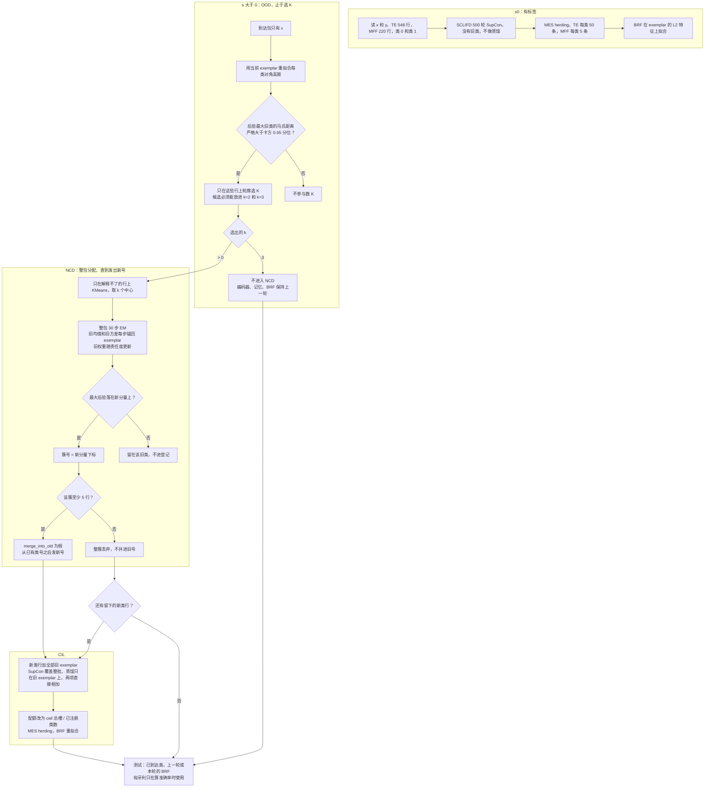

# 同一次分配、到达包自估 K

日期：2026-10-27。选 K 是 OOD 的最后一步，初值和 30 步 EM 在 NCD。`..._joint_sil_ncd` 重跑后，漏入、旧类、终局准确率和伪新类与 `..._joint_sil` 相同。旧目录不覆盖。蒸馏系数和种子配额不在主路径里。

配置：

- `OpenFCIFD/configs/experiments/te_imbalanced_openworld_sclifd_gmm_raw_mix_kmraw_keepnew_joint_sil_ncd.yaml`
- `OpenFCIFD/configs/experiments/mff_imbalanced_openworld_sclifd_gmm_raw_mix_kmraw_keepnew_joint_sil_ncd.yaml`

结果目录：

- `OpenFCIFD/outputs/te_imbalanced_openworld_sclifd_gmm_raw_mix_kmraw_keepnew_joint_sil_ncd`
- `OpenFCIFD/outputs/mff_imbalanced_openworld_sclifd_gmm_raw_mix_kmraw_keepnew_joint_sil_ncd`

会话文件与基线逐元素相同：`sysbaseline/te_sessions.npz`、`sysbaseline/mff_sessions.npz`。种子 66，`way=2`。到达方式 `mix_seen`，`mix_id_source=leftover`，`mix_id_ratio=0.2`。0.2 是到达包里已见类行所占的比例。这些行来自训练文件里被丢掉的 `X_mix.npy`，不从测试集抽。进高斯和进 KMeans 时不再做 z-score，坐标是已经缩放到 $[0,1]$ 的监测向量。

| | s0 训练 | s≥1 到达 | 测试，只含截至本轮已到达的类 |
| --- | --- | --- | --- |
| TE，52 维 | 548 行，类 0、1，有标签。类 0 为 500，类 1 为 48 | 每轮 120 行：已见 24，新类 96 | 1760，3360，4960，6560，8160 |
| MFF，23 维 | 220 行，类 0、1，有标签。类 0 为 200，类 1 为 20 | 每轮 50 行：已见 10，新类 40 | 1600，3200，4800 |

s0 训练读 `x` 和 `y`。s1 起训练只读到达包的 `x`。`y` 只在评测时读。这两份 yaml 没有 `openworld.labels: oracle`，`experiment.py` 传给 `run_session` 的标签是空的。未来类不进本轮训练，也不进本轮测试。TE 五轮，MFF 三轮。记忆总槽 TE 为 100，MFF 为 10，不随轮次增加。

## 1. 三段各做什么

会话按 OOD、NCD、CIL 的顺序调用。OOD 在选出 $\hat{K}$ 处停下。NCD 从取初值做到发出新号：整包分配、丢掉少于 5 行的簇、不并回旧号。CIL 从新号已经发出才开始。

| 段 | 代码 | 这一版实际做的事 |
| --- | --- | --- |
| OOD | `openfcifd/algorithms/ood/gmm.py`，`gate: anchored_em`，`n_new: silhouette` | 用当前 exemplar 拟合每类一个对角高斯。残差取后验最大的那个旧类。只在残差严格大于卡方 0.95 分位的行上选 K。$\hat{K}=0$ 时不进入 NCD |
| NCD | `openfcifd/algorithms/ncd/anchored.py`，登记在 `openfcifd/update/centroid.py` | $\hat{K}>0$ 时只在上述行上取 KMeans 初值，再在整包上做 30 步 EM。最大后验落在新分量上的行得到簇号。少于 `min_cluster_size=5` 的簇整簇丢弃。最近旧质心的距离仍会计算，`merge_tau=0.5`；`merge_into_old: false` 丢掉对齐器给出的旧号，从已有类号之后发新号。yaml 里的 `n_clusters: 2` 不参与发现 |
| CIL | `openfcifd/algorithms/cil/sclifd.py` | 本轮留下的新类行拼上全部旧 exemplar。SupCon 加在这整批上，不是只加在新类行上。旧 exemplar 对训练前的冻结副本做特征相似度蒸馏，损失直接相加，没有系数。然后 MES herding，再在更新后的 exemplar 上拟合平衡随机森林 |

`update_scope` 在这两份 yaml 里没有写成 `new_head`，类默认值是 `all`。因此监督对比损失覆盖新类行和旧 exemplar。蒸馏只在批内的旧 exemplar 行上计算。

k=0，或登记后没有留下的新类行时，走 `no_ood` 或 `label_space_empty`：本轮不更新编码器、exemplar 和 BRF，`session_id` 仍加 1。外层仍用上一轮的 BRF 在已到达类上算测试准确率。

## 2. 路线

卡方界限只用来数 K 和取初值。30 步之后，一行是否进入登记只看最大后验落在哪个分量，不看它的残差有没有超过界限。残差以内的行可以被一个新分量吸走；残差以外的行也可以留在旧分量上。

轮廓在能开出候选时不会返回 1。解释不了的行若其实是一个新故障，只要条数够比较 k=2 和 k=3，选出的个数仍至少是 2。返回 0 只表示搜索区间放不进这两个候选，不表示模型判断“没有新故障”。

## 3. s0

这一轮不估 K，不做 EM。

1. 读 s0 的 `x` 和 `y`。类号只有 0 和 1。
2. 残差 MLP，宽度 64、128、256、512，特征 512 维。训练 500 轮。Adam，学习率 0.01，权重衰减 $10^{-5}$。学习率在第 200、400 轮乘 0.2。批大小 2048。两个视图来自 `item_reorder`，重排比例 $\beta=0.6$。损失是 SupCon，温度 0.07。没有旧类，不做蒸馏。
3. 每类配额 $\lceil M/2\rceil$。TE 为 50，MFF 为 5。MES herding 在编码器特征上挑 exemplar，先挑离当前均值更远的样本。
4. 平衡随机森林在这些 exemplar 的逐行 L2 特征上拟合。200 棵树，`random_state=42`，`sampling_strategy=auto`，`replacement=True`，`bootstrap=True`。s0 的测试准确率由这个森林给出。
5. s0 结束时会在全部训练行上拟合一次高斯。s1 开始时不用这 548 或 220 行，而是用当时的 exemplar 重拟合锚点。

## 4. s1 及以后

每轮按这个顺序做。到达包的真标签不进入其中任何一步。

1. **重拟合锚点。** `fit_on: exemplars`。当前 herding 行按类拟合对角高斯：`GaussianMixture`，`covariance_type=diag`，`components_per_class=1`，`reg_covar=1e-4`，种子 66。类先验是该类记忆条数占记忆总条数的比例。s1 的类只有 0 和 1。之后每一轮包含当时已经注册的类。
2. **算残差。** 对到达包每一行，取后验最大的旧类，算对角马氏距离 $\sum_d (x_d-\mu_d)^2/\sigma_d^2$。界限是 `chi2.ppf(0.95, 列数)`，当场计算。52 维约为 69.8322，23 维约为 35.1725。这两个数不写进代码，也不写进 yaml。
3. **划出用来数 K 的行。** 残差严格大于界限的行进入下一步。其余行不参与轮廓，也不因此得到训练标签。yaml 里的 `percentile: 95` 会在 `fit` 时算出一个分数阈值并打印。`anchored_em` 不使用这个阈值。
4. **选新分量个数。** 搜索区间是 $[\max(2,k_{\min}),\min(k_{\max},n-1)]$，$k_{\min}=2$，$k_{\max}=8$。区间不能同时放进 k=2 和 k=3 时返回 0。否则每个 k 用 `KMeans(n_clusters=k, n_init=10, random_state=66)`，取轮廓系数最大的 k。并列时留下较小的 k。打印这些行的条数、界限、维数、每个 k 的轮廓和选出的 k。
5. **k 为 0。** OOD 到此结束，不进入 NCD，不调用 KMeans。`run_session` 走 `no_ood`。漏入记 0，因为没有任何行被标成发现。这一版的六个到达包都没有走到这里。
6. **k 大于 0 时取初值。** 这一步起属于 NCD，对象仍是整包到达。只在第 3 步的行上做 KMeans，簇数等于 k。这 k 个中心是新分量的均值初值。新分量的初始方差是到达包各维方差的均值再加上 `1e-4`，不是先与 `1e-4` 取较大者。随后每步更新仍把方差下界夹在 `1e-4`。
7. **30 步 EM。** 混合包含全部旧分量和这 k 个新分量，计算在整包上进行。权重初始为均匀的 $1/L$。每一步先算整包每一行的后验，再更新分量。更新后把旧分量的均值和方差设回第 1 步的 exemplar 高斯。旧分量的权重随责任度更新，不锚回记忆频率。新分量保留本步的均值、方差和权重。
8. **读最大后验。** 最大后验落在旧分量上的行留在该类，簇号记 -1，不进注册。落在新分量上的行，簇号等于该分量下标减去旧分量个数。
9. **丢掉小簇。** 仍在 NCD 内。一个新簇少于 5 行就整簇丢弃，`conf_tau=0`。丢弃的行不进 SCLIFD，也不并进旧号。
10. **发出新号。** NCD 的最后一步。直接使用第 8 步的簇号。最近历史质心的 L2 距离若不超过 0.5，对齐器会给出旧号；`merge_into_old: false` 丢掉这个旧号，从已有类号之后发新号。
11. **更新编码器。** 由此进入 CIL。训练行是本轮留下的新类行，再拼上全部旧 exemplar。500 轮，优化器和 SupCon 与 s0 相同。SupCon 用这整批的标签。旧 exemplar 对训练前的冻结副本做特征相似度蒸馏：学生和教师各自把这些行的非对角相似度做成分布，蒸馏项是它们的交叉熵，`loss = loss + loss_distill`。没有留下的新类行时不进入这一步，编码器和记忆保持上一轮。
12. **重做记忆并重拟合 BRF。** 配额改成 $\lceil M/C\rceil$，$C$ 是当时已注册类数。旧 exemplar 截到这个长度。新类用本轮留下的行做 MES herding。BRF 只在更新后的 exemplar 上拟合。
13. **下一轮的锚点。** 不把本轮发现行累进一个与 exemplar 平行的拟合集。下一轮开始时仍只用当时的 exemplar 重拟合对角高斯。

测试集是截至本轮已经到达的类。一行先过残差 MLP，特征 L2 归一化，再由 BRF 给出类号。k 为 0 的轮次用上一轮的 BRF。s0 的类 0、类 1 用原号直接比。后来发出的号只在算准确率时用匈牙利对齐，对齐结果不写回类号、簇或 exemplar。

漏入的分母只算到达包里的已见行。分子是这些行里最大后验落在新分量上的条数，在丢掉小簇之前计算，读 `ncd/discover_index.npy`。

`experiment.py` 在调用 `run_session` 之前，会把本轮测试集上的已知行和未知行拼起来再调用一次 `ood.score`。这次会再选一次 K，不做 EM，不进 `LabelSpace`。到达包才打印 `GMM anchored EM`，其中 `n` 为 120 或 50。`ood_auroc` 用的是旧高斯的负对数密度，要报的数不使用它。

## 5. 这一版的数

和固定 K 的同一次分配比，不把会话平均当成胜负。固定 K 的目录是 `..._kmraw_keepnew_joint`，不覆盖。

| | 固定 K 的同一次分配 | 本次到达包估 K |
| --- | --- | --- |
| TE s1 漏入 | 12.5% | 12.5% |
| TE 类 1 在 s1 | 97.5% | 97.5% |
| TE s4 | 55.3% | 58.0% |
| TE 类 3 在 s4 | 0.1% | 0.0% |
| MFF s1 漏入 | 20% | 20% |
| MFF 类 0 在 s1 | 91.8% | 99.1% |
| MFF s2 | 96.0% | 96.7% |
| MFF 类 3 在 s1 | 100% | 100% |

到达包上的选择：TE 四轮解释不了的行是 69、103、74、64，选出的 k 都是 2，`discover` 为 50、96、85、85，每轮登记 2 个新号，`false_new` 为 0。MFF 两轮是 45 行选出 k=3、44 行选出 k=2。s1 的第三个簇只有 2 行，被最少 5 行丢掉，登记仍是 2 个新号，`false_new` 为 0。`discover` 为 42、41。

各轮测试准确率：TE 99.2%、71.9%、78.4%、64.0%、58.0%。MFF 99.5%、99.8%、96.7%。日志里的 `avg acc` 是已知类平均，TE 88.3%、MFF 97.0%，不是上表的测试准确率。

TE 类 0 的测试准确率，分母每轮都是 960：s0 99.8%，s1 96.7%，s2 90.5%，s3 80.2%，s4 38.5%。类 1 在 s4 是 96.4%。类 3 从 s1 起就在测试类别中，每轮登记数等于真实新类数，s4 准确率仍是 0。s4 类 0 的 590 条错分里，553 条落到类 8。

MFF 类 0 在 s2 是 84.8%。类 3 在 s1 和 s2 都是 100%。

对齐蒸馏和种子配额已经跑完，都不留在主路径里。对齐蒸馏把 TE 类 0 在 s4 降到 24.7%，类 1 在 s1 降到 97.0%。种子配额把 TE 类 0 在 s4 抬到 49.8%，但 s4 测试准确率降到 53.5%，s4 漏入升到 25%，s3 多登记 1 个假新类。
